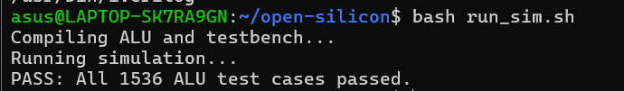
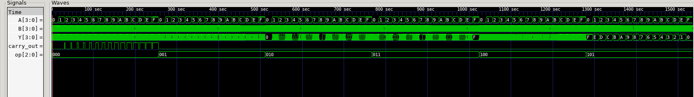
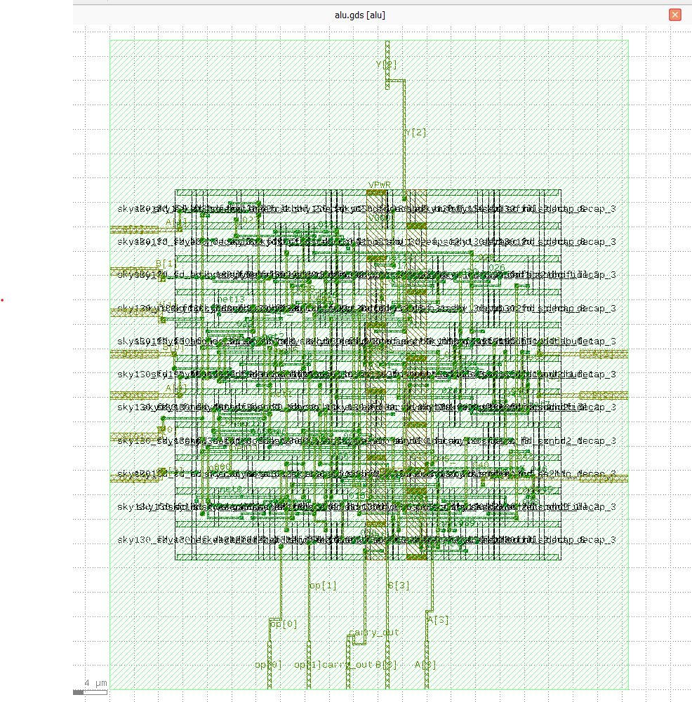

# Open Silicon: A 4-Bit ALU ASIC Experiment

An simple project exploring an open-source ASIC design flow,
from Verilog RTL to a physical GDSII layout.

## Project Overview

This 4-bit Arithmetic Logic Unit (ALU) supports:
- Addition with carry-out
- Subtraction
- Bitwise AND
- Bitwise OR
- Bitwise XOR
- Bitwise NOT

## Tools Used

- Verilog for RTL design
- Icarus Verilog for simulation
- Yosys for logic synthesis
- OpenLane 2 for physical design
- SkyWater SKY130 PDK
- KLayout for layout inspection

## Run the Simulation

Requirements: Icarus Verilog installed and available in your PATH.

Run the testbench from the project root:

```bash
./run_sim.sh
```

The testbench checks 1,536 cases across the six supported operations.

## Simulation Results

The ALU testbench verified all 1,536 input combinations across the six supported operations.



All test cases passed during functional simulation using Icarus Verilog.

## Simulation Waveform

The ALU's functional behavior was inspected using GTKWave after running the Icarus Verilog testbench.



All 1,536 test cases passed across the six supported ALU operations.


## Physical Layout

The following image shows the ALU layout generated during this
open-source ASIC design experiment.



## Design Flow

1. **RTL design:** Describe the 4-bit ALU in Verilog.
2. **Functional verification:** Use Icarus Verilog to test the
   ALU operations. All 1,536 test cases passed.
3. **Logic synthesis:** Use Yosys to translate the RTL into a
   gate-level representation.
4. **Physical implementation:** Run OpenLane 2 with the
   SkyWater SKY130 PDK.
5. **Layout inspection:** Inspect the generated GDSII in KLayout.

Run the simulation from the project root:

```bash
iverilog -o alu_test alu.v tb_alu.v
vvp alu_test

```

The completed OpenLane run reported passing DRC, LVS, and
antenna checks. This project is an educational experiment,
not a fabricated chip or production signoff.

## Future Improvements

- Add reproducible setup and OpenLane execution instructions.
- Document synthesis and physical-design reports.
- Investigate timing constraints and physical-design warnings.
