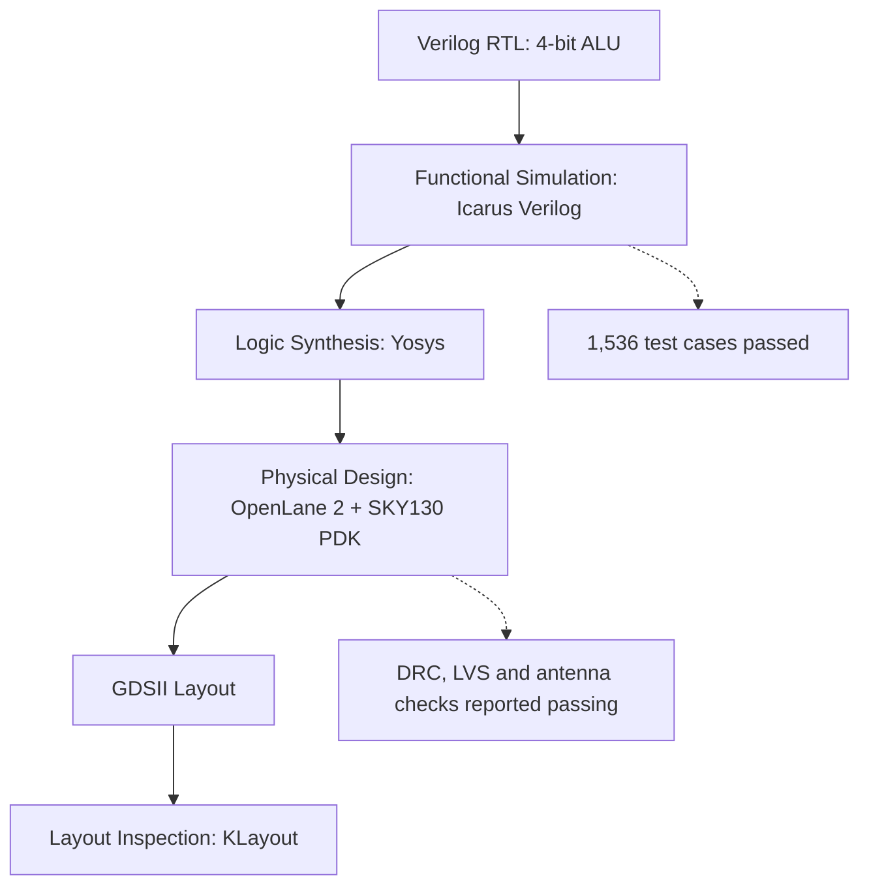

# Open Silicon: Design Architecture

## 1. Overview

This project demonstrates an open-source ASIC design workflow using a 4-bit Arithmetic Logic Unit (ALU). It covers RTL design, functional verification, logic synthesis, physical implementation, and layout inspection.

## 2. Design Architecture and Toolchain



## 3. Design Flow

1. **RTL Design:** The ALU is described in Verilog and supports addition, subtraction, bitwise AND, bitwise OR, bitwise XOR, and bitwise NOT.

2. **Functional Simulation:** Icarus Verilog runs the testbench to verify the ALU. All 1,536 test cases passed.

3. **Logic Synthesis:** Yosys translates the RTL into a gate-level representation.

4. **Physical Design:** OpenLane 2 uses the SKY130 Process Design Kit (PDK) to implement the design through the ASIC flow.

5. **Layout Generation:** The generated GDSII layout can be inspected using KLayout.

## 4. Verification Results

### Functional Verification

Run the simulation from the project root:

```bash
./run_sim.sh
```

Expected result:

```text
PASS: All 1536 ALU test cases passed.
```

### Physical Verification

The completed OpenLane run reported passing DRC, LVS, and antenna checks. These reported results do not establish production-ready silicon signoff.

## 5. Important Notes and Limitations

- **Educational scope:** This is an educational design experiment. The chip has not been fabricated.
- **Clock configuration:** The current ALU is combinational and has no configured clock port.
- **Timing constraints:** A fallback generic SDC configuration was used. The experiment does not establish a validated maximum operating frequency.
- **IR-drop analysis:** The run reported an IR-drop warning associated with missing `VSRC_LOC_FILES`.
- **Signoff:** Passing reported physical checks does not establish production signoff or fabrication readiness.

## 6. Reproducing the Experiment

See the following documents for more information:

- [Reproduction Guide](REPRODUCING.md)
- [OpenLane Results](OPENLANE_RESULTS.md)

## 7. Project Outcome

This project demonstrates a learning workflow connecting digital logic design, functional verification, synthesis, and physical layout generation using open-source EDA tools.
